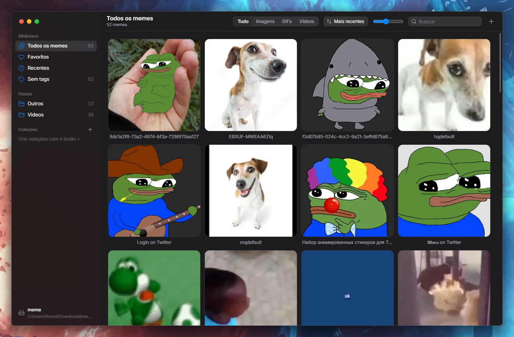

<div align="center">


# 🗄️ Meme na Gaveta

**Seus memes organizados, a um clique de distância.**

Organizador de memes para Windows (imagens, GIFs e vídeos), com visual inspirado no macOS.
Portátil, leve (~4 MB) e 100% offline.


<br />



</div>

---

## ✨ O que ele faz

- 📁 **Usa a sua pasta de memes**: você escolhe a pasta e o app indexa tudo o que tem dentro, subpastas inclusive. Nada é movido nem renomeado.
- 🔗 **Pastas extras**: dá para adicionar outras pastas (outro HD, Downloads...). Elas são lidas onde estão, sem cópia.
- 🏷️ **Tags, coleções e favoritos** para achar o meme certo na hora.
- 🔎 **Busca instantânea** por título, tag ou nome do arquivo, sem se preocupar com acentos.
- 📋 **Copiar e colar de verdade**: GIFs e vídeos vão para a área de transferência como arquivo, então chegam **animados** no Discord e no WhatsApp.
- 🖱️ **Arrastar e soltar** os memes direto para o Discord, o WhatsApp ou o Explorer.
- 👀 **Quick Look**: aperte `Espaço` para ver o meme grande e navegue com as setas.
- 🔄 **Sincronização automática**: mexeu na pasta pelo Explorer? O app percebe sozinho. Arquivos renomeados ou movidos **mantêm as tags**.
- 🗑️ **Sem perda acidental**: apagar manda o arquivo para a Lixeira, nunca exclui de vez.
- 🌗 **Tema claro e escuro** acompanhando o Windows, com efeito Mica na barra lateral.

## 💾 Portátil de verdade

Não tem instalador: é **um único `.exe`**. Tudo o que o app grava fica ao lado dele, na pasta `MemeNaGaveta-dados\`, e
nada vai para o AppData. Dá para levar num pendrive.

As tags, coleções e favoritos ficam num arquivo `.memenagaveta.json` **dentro da sua pasta de memes**. Se você copiar
a pasta para outro PC, a organização vai junto. 🎒

> ⚠️ Coloque o `.exe` numa pasta onde você pode gravar (Documentos, Desktop...). Dentro de `Arquivos de Programas`
> ele não consegue salvar as configurações.

## 🚀 Como usar

1. Baixe o `.zip` em **[Releases](../../releases)** e extraia.
2. Abra o `MemeNaGaveta.exe`.
3. Escolha a pasta onde estão (ou vão ficar) seus memes.
4. Pronto! Arraste arquivos para a janela, cole com `Ctrl+V` ou use o botão **+**. 🎉

Formatos aceitos: `png` `jpg` `jpeg` `webp` `bmp` `avif` `gif` `mp4` `webm` `mov`

## ⌨️ Atalhos

| Tecla | Ação |
| --- | --- |
| `Espaço` | Quick Look |
| `Enter` / `Ctrl+C` | Copiar o meme |
| `Ctrl+V` | Colar como novo meme |
| `Ctrl+O` | Adicionar arquivos |
| `Ctrl+Shift+O` | Adicionar pasta |
| `Ctrl+F` | Buscar |
| `F` | Favoritar |
| `Delete` | Mandar para a Lixeira |
| `Ctrl+A` | Selecionar tudo |
| `←` / `→` | Navegar |
| `Esc` | Limpar seleção |

## 🛠️ Desenvolvimento

### Tecnologias

| Camada | Tecnologia |
| --- | --- |
| 🖥️ Desktop | Tauri 2 (WebView2) |
| 🦀 Backend | Rust |
| ⚛️ Interface | React 19 + TypeScript + Vite |
| 🎨 Estilo | Tailwind CSS v4 |
| 🧠 Estado | Zustand |
| 🎬 Animações | Motion |

### Pré-requisitos

- [Node.js](https://nodejs.org/) 20 ou mais novo
- [Rust](https://rustup.rs/) (via rustup)
- WebView2 (já vem no Windows 10/11)

### Comandos

```bash
npm install        # instala as dependências
npm run dev        # abre o app em modo desenvolvimento (hot reload)
npm run typecheck  # checa os tipos do frontend
npm test           # roda os testes do backend
npm run dist       # gera release/MemeNaGaveta.exe e o .zip portátil
```

### Estrutura

```
src/              🎨 Interface (React)
  components/     Sidebar, grade, Inspector, Quick Look, menus...
  store.ts        Estado, busca e filtros
  api.ts          Ponte com o backend
src-tauri/src/    🦀 Backend (Rust)
  library.rs      Varredura da pasta, índice e reconciliação (com testes)
  commands.rs     Comandos chamados pela interface
  lib.rs          Janela, watcher da pasta e gravação do índice
```

---

<div align="center">

Feito com ☕ e muitos memes por **[ZaxFelipe](https://github.com/ZaxFelipe)**

</div>
